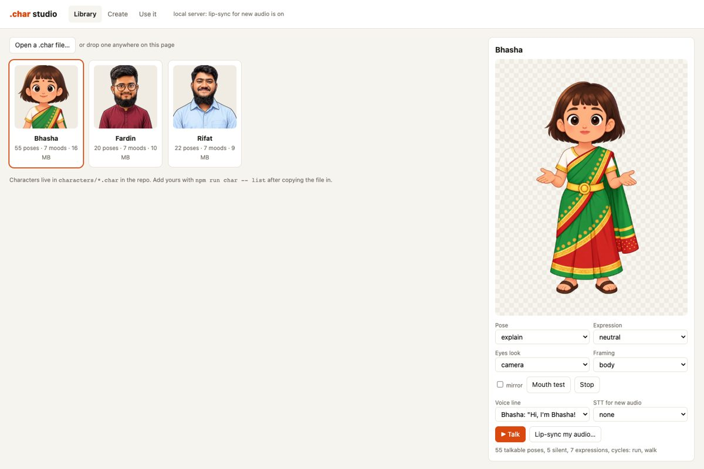
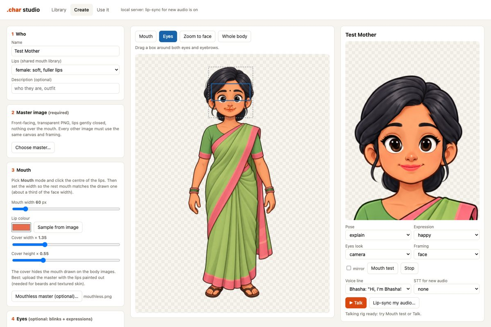
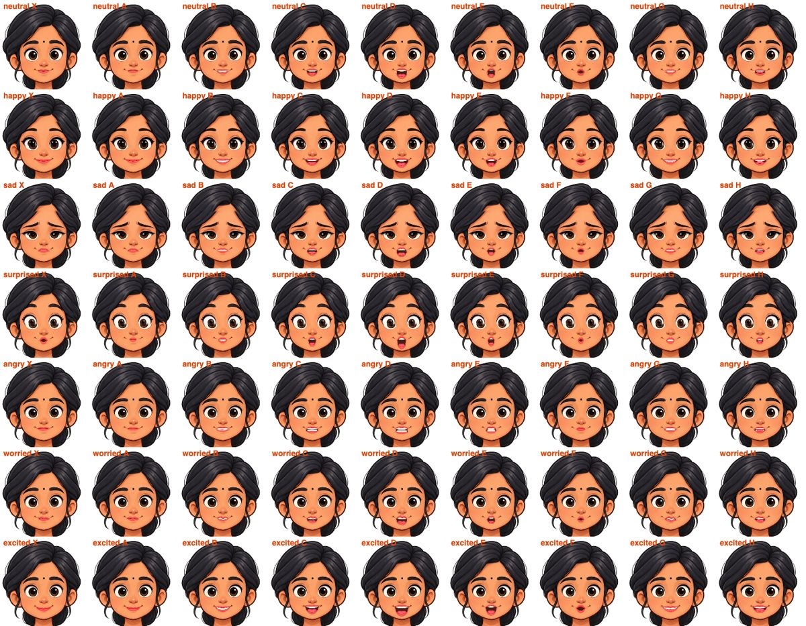

# .char: talking characters you can drop in anywhere

One file per character. Any `.char` can talk, change expression and pose, and walk in a **web page, an HTML slide, a rendered video (MP4 or transparent overlay) or a multi-character scene**. You don't rig anything again and you don't generate new images per video.

Comes with **Bhasha, Fardin, Rifat and Prapti**, ready to use.



## Setup (once)

Needs Node 18+, ffmpeg and Google Chrome.

```sh
git clone https://github.com/raied10ms/dotchar && cd dotchar
npm install
npm run setup        # downloads Rhubarb Lip Sync (the mouth-timing engine)
npm run studio       # -> http://localhost:8790/studio/
```

Optional keys go in a `.env` file in the repo root. They are never committed.

```
DEEPGRAM_API_KEY=...   # word timings for better mouth shapes (or OPENAI_API_KEY for Whisper)
OPENAI_API_KEY=...     # only for generating new character images
```

## Use a character

**Web page / slide.** One script and one tag. Click the character to play the line. Live examples: `examples/web/`, `examples/slide/`.

```html
<script type="module" src="runtime/char-player.js"></script>
<char-player src="characters/bhasha.char" audio="line.mp3" track="line.lipsync.json"
             pose="explain" expression="happy" fit="bust" width="540" height="720"></char-player>
```

**Video**

```sh
npm run char -- lipsync line.mp3 --stt deepgram                       # -> line.lipsync.json
npm run char -- render --char characters/fardin.char --audio line.mp3 \
     --pose explain --expr happy --fit bust --size 1080x1920 -o fardin.mp4
npm run char -- render --char characters/fardin.char --audio line.mp3 \
     --bg transparent -o fardin.webm                                    # overlay in Premiere / CapCut / AE (.mov = ProRes 4444)
```

Change poses and expressions over time with `--cues cues.json`, e.g. `[{"at":1.2,"pose":"point","dur":1.5},{"at":2,"expr":"surprised"}]`.

**Conversation / episode.** A JSON scene: cast, voice lines, timeline, camera. Writers edit data, not code. See `examples/scene/scene.json`.

```sh
npm run char -- render --scene examples/scene/scene.json -o scene.mp4
```

**Your own code (canvas, Remotion, games)**

```js
import { loadChar } from './runtime/char.js';
import { Performance } from './runtime/player.js';
const rifat = await loadChar('characters/rifat.char');
const perf = new Performance(rifat, { track, pose: 'explain', expression: 'happy' });
perf.draw(ctx, t, perf.fit(canvas.width, canvas.height, 'bust'));   // t = audio time, or frame / fps
```

What can each character do? `npm run char -- validate characters/bhasha.char` lists its talkable poses, silent poses, expressions and walk/run cycles.

## Make a new character

Pick one route:

| You have | Do this |
|---|---|
| A finished drawing + a few edited copies (eyes closed, a few poses) | Studio → **Create**. Click the lips, drag the eye box, add poses, then **Download .char** |
| Just a reference (photo, book illustration, sketch) | `tools/gen-images.mjs` generates the full image set with an AI image model, then load it in the Studio (or `char build`) |
| A folder of images + `build.json` (from the Studio's **Save build.json**) | `npm run char -- build <folder> --sheet qa.png` (no clicking) |



**Painterly or realistic face, or a beard or moustache?** Give the character *drawn mouths*: `tools/drawn_mouths.py` + `tools/gen-mouths.mjs` draw the 9 mouth shapes on the character's own face (8 image calls), and `tools/judge.mjs` asks a GPT vision model for a second opinion. The flat library mouths look pasted on such faces.

Read **[docs/METHOD.md](docs/METHOD.md)** first. It has the image rules that make lip-sync look right: front-facing master, lips closed, nothing over the mouth, head locked in every pose. Then check the QA sheet:



When it looks right, put the file in `characters/`, run `npm run char -- list` (this refreshes the library index and thumbnails) and open a pull request.

## Claude Code skill

`skill/SKILL.md` teaches Claude Code the whole workflow: generating images, rigging, QA, rendering and embedding. To install it:

```sh
mkdir -p ~/.claude/skills && ln -s "$PWD/skill" ~/.claude/skills/char-rig
```

Then ask Claude, for example: *"make a lip-synced character from this photo"* or *"render Fardin saying this line, bust shot, 9:16"*.

## Repo map

```
characters/   *.char library + index.json + thumbs/          SPEC.md      the .char format
runtime/      char.js (load) · puppet.js (draw) · player.js (one take) · char-player.js (<char-player>) · scene.js/actor.js (scenes)
lipsync/      audio + words -> viseme track                  cli/         npm run char -- …
studio/       browser app: library, create, embed snippets   render/      headless pages used by the CLI
mouthlib/     shared mouths: female/male × 7 moods × 9 visemes
tools/        setup-rhubarb · gen-images (AI image set) · drawn_mouths + gen-mouths (mouths in the character's own style)
              judge (GPT vision QA) · facial_hair.py · import_rig.py (legacy rig folders -> .char)
examples/     web page · slide · scene · from-images (build.json example) · audio samples
```

## Licence

- Code: MIT (`LICENSE`).
- Characters, voices and example art: © 10 Minute School, all rights reserved (`characters/LICENSE.md`).
- Fardin and Rifat are likenesses of real people. Use them only for 10 Minute School work, and only with their consent.
- Rhubarb Lip Sync is MIT, © Daniel S. Wolf, downloaded by `npm run setup`.
