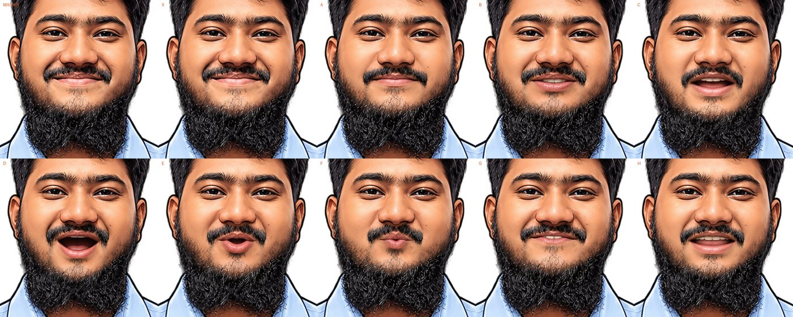

# How the characters are rigged (and how to make a good one)

## The idea in one paragraph

We don't animate the body bone by bone. Each body pose is one finished drawing, and only the **face** is rigged. A character is:

- a set of full-body pose images that all keep the head in the same place,
- a **cover**, a small skin patch drawn over the mouth on the body images,
- **eye tiles** for blinking and for each expression,
- a **mouth** in 9 shapes (visemes). It comes either from one shared library, scaled and recoloured for this face, or from shapes drawn on the character's own face (see "Two kinds of mouth").

For each pose we measure where the head moved compared to the master (the `head` transform) and draw the face layers through that transform. So one set of face layers talks on every pose. A 40-minute episode needs no new images. It is just data: a pose name, an expression and a lip-sync track for each moment.

```
pose image ──► cover (hides the drawn mouth) ──► eyes (expression / blink / gaze) ──► glasses/bindi ──► library mouth (viseme)
                └──────────── all through the pose's head transform (master → pose) ────────────┘
```

## Two kinds of mouth: pick by art style

| | **Library mouths** | **Drawn mouths** |
|---|---|---|
| What | One shared set of flat cartoon mouths (9 shapes × 7 moods), scaled and recoloured | 9 shapes drawn by the image model **on this character's own face**, in its own style |
| Use for | Flat, cel-shaded cartoon characters (Bhasha) | Painterly or realistic faces, caricatures of real people, anyone with a **beard or moustache** (Fardin, Rifat, Prapti) |
| Cost | No image calls | 8 image calls per character, plus re-rolls |
| Rest pose | A library rest mouth over a skin cover | The approved master's own mouth, untouched |
| Moods | Mouth changes with the expression | One mouth set; expressions change the eyes and brows only |

A flat cartoon mouth on a painted face looks pasted on: the style doesn't match, the rest mouth replaces the person's real smile, and facial hair gets covered. If the QA sheet shows any of that, switch to drawn mouths. Don't try to fix it by resizing or layering.



### How drawn mouths are made

```sh
python3 tools/drawn_mouths.py prep work/<id>/mouths --master master.png --lips x0,y0,x1,y1   # head crop of the master
node tools/gen-mouths.mjs work/<id>/mouths --style "the same painterly style as the supplied image"   # 8 edits
python3 tools/drawn_mouths.py apply work/<id>/mouths <unpacked char folder> --sheet qa.png
node tools/judge.mjs --guide work/<id>/mouths/crop.png --render qa.png                        # second opinion
```

1. **Prep** crops the master's head and scales it up, so the model works at high resolution on the face only.
2. **Generate** edits that crop once per mouth shape. The briefs ask for calm classroom speech, with facial hair kept in place.
3. **Apply** lines each result up with the master using everything *except* the mouth area, matches the skin tone at the patch edge, and keeps only a soft-edged patch around the mouth. Everything outside the patch is always the master's own pixels. The rest shape (X) is the master itself.
4. **Judge** sends the sheet to a GPT vision model, which scores likeness, integration, facial hair, rest pose, shapes, stability and naturalness, and lists concrete fixes.

What goes wrong, and the fix:

| On the sheet | Fix |
|---|---|
| A shape looks like shouting, grinning or a kiss | Re-roll that shape: `gen-mouths.mjs … --only D --force`. Add `--note "smaller opening"` if it repeats |
| G doesn't show teeth on the lip, or H shows no tongue tip | Re-roll that shape. These two need the most tries |
| Moustache or hair under the lip thinned or erased | Re-roll that shape. Never accept it |
| Jaw or chin outline shifts between shapes | Re-roll; or shrink the patch with `apply --rx 0.75 --ry 0.58` |
| Skin tone steps at the patch edge | `apply` reports "edge difference"; above 18, re-roll that shape |

Read the judge's fixes, but don't chase a perfect score. It is deliberately harsh: the three shipped teachers score 6–8 per criterion, with 10 for rest pose. Stop when likeness and rest pose are high, facial hair is intact, and no single shape looks wrong to *you* at playback size.

**Library mouths on a bearded face (fallback, no image calls).** Turn on **Beard or moustache** in the Studio, or set `"facialHair": true` in `build.json`. The cover shrinks to the lips only, and the moustache is drawn over the mouth as an `overMouth` layer. It keeps the hair visible, but the mouth is still a flat cartoon one, so use drawn mouths for anything that will be seen up close.

## Lip-sync, in three evidence sources

`npm run char -- lipsync line.mp3 --stt deepgram` makes a track that **every** character can use.

1. **Acoustic timing (Rhubarb 1.14).** When the mouth opens and closes. This is the backbone. Install it with `npm run setup`.
2. **Text shapes.** STT words → phonemes (CMU dictionary for English, grapheme rules for Bangla), placed inside each word by aligning the expected jaw opening to the loudness curve. This decides which shape the mouth makes.
3. **Loudness.** Gates breaths and pauses (the mouth stays shut) and drives a continuous `open` value for a subtle jaw stretch.

Fusion then fixes the errors viewers notice:

- an M/B/P always gets a closed-lips frame;
- OO and OH are rounded;
- F and V show teeth on the lip;
- one-frame flickers are removed.

Without STT it still works (acoustic only). Without Rhubarb it falls back to text + loudness, which is noticeably worse.

**Bangla / Banglish:** English STT drops Bangla words. Pass `--lang bn` with `--stt openai`, or hand-write the words file.

## Rules for the images (these decide whether lip-sync looks right)

**Master (the one image that defines identity)**
- Full body, **front-facing**, standing, arms a little away from the body, transparent background, feet near the bottom with some padding.
- **Lips gently closed**, no teeth. The cover then only has to hide a thin line, not a hole.
- Mouth about **⅓ of the face width**, with at least one mouth-width of chin below it. The wide-open mouth drops the jaw.
- **Nothing on or touching the mouth**: no hand, hair, scarf or mask. Beards and moustaches are OK if the lips and a thin margin around them stay bare. Give those characters **drawn mouths** (above).
- Glasses are OK if the lenses are clear and bigger than the eyes.

**Every other image is an edit of the master. Never redraw the character from scratch.**
- Same canvas size, same framing, same character size.
- **Poses:** the head stays exactly as in the master: same size, angle and position, facing the viewer. Hands never cover the face. Head match ≥ 0.86 = talkable. Lower than that, the pose becomes silent or you nudge it by hand.
- **Mouthless:** only the lips become skin; everything else is identical.
- **Eyes closed / expressions:** only the eyes and brows change. The builder cuts just the eye box out of these, so stray changes elsewhere don't matter.
- **Walk/run:** side view facing right; 4 frames side by side in one image is fine (the builder splits them).

**Real people (teachers)**
- Use likeness mode: give every photo you have, best frontal one first, and write the outfit down.
- **Get the master approved by the person first.** After approval, never regenerate their face. Every regeneration drifts the likeness. Fix small problems by hand (pixel edits) instead.
- Publish only with their consent.

## Framing on screen (mouth readability)

| Shot | Rest mouth width in a 1080p frame | What reads |
|---|---|---|
| Wide (full body) | ~20–25 px | open/closed only. Fine for background chatter |
| Medium (waist up, `fit: bust`) | ≥ 35 px | all 9 shapes |
| Close-up (`fit: face`) | 60–110 px | best. Use it for important lines |

## Quality checks before you share a character

0. Drawn mouths: `tools/drawn_mouths.py apply … --sheet qa.png`, then `tools/judge.mjs` (above).
1. Library mouths: `npm run char -- build <folder> --sheet qa.png`. The sheet shows every mood × every mouth. Look for:
   - mouths too big or too small for the face,
   - wrong lip colour,
   - a visible cover patch,
   - the jaw crossing the chin.
2. Studio → Library → open it → **Mouth test** on every talkable pose, at `face` framing. If the mouth drifts off the lips, the head match is bad.
3. Render one real line: `npm run char -- render --char x.char --audio line.mp3 --fit face`.
4. `npm run char -- validate x.char` must show no errors.
